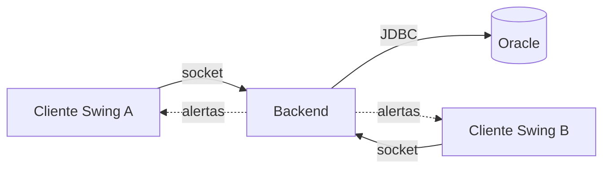

# Sistema de Reserva de Recursos — Proyecto 2

Curso EIF206 Programación 3 — Universidad Nacional de Costa Rica.

Versión distribuida del Proyecto 1: varios clientes Swing (Frontend) se conectan
por sockets a un único servidor sin interfaz (Backend), que aplica las reglas y
guarda los datos en Oracle. Cuando alguien crea una reserva, los demás usuarios
conectados reciben una alerta al instante.

> **Base de datos:** se usa Oracle en lugar de MySQL (que menciona el enunciado)
> por indicación del profesor. También por su indicación, la base es local en la
> computadora del servidor. Como pide el enunciado, Frontend y Backend sí pueden
> correr en máquinas distintas: los clientes solo hablan con el servidor por sockets.

## Requisitos

- JDK 17 o superior.
- Oracle XE y SQL Developer (o SQL*Plus).
- IntelliJ IDEA (u otro IDE con Maven). Es opcional: también se ejecuta desde la terminal.

No hace falta instalar Maven: el proyecto trae el Maven Wrapper (`mvnw`).

## Ejecución rápida

### 1. Preparar la base (una sola vez)

1. En SQL Developer, crear una conexión **SYSTEM** (host `localhost`, puerto `1521`,
   SID `XE`, con la clave de SYSTEM definida al instalar Oracle XE), abrir
   `DB/00_crear_usuario.sql` y ejecutarlo con **F5**. Aparece un diálogo que pide
   una clave: escribir una cualquiera, sin comillas; será la clave del usuario del
   proyecto, `RESERVAS_P2`.
2. Crear una segunda conexión con usuario **RESERVAS_P2** y esa clave (mismo host,
   puerto y SID). En ella, ejecutar con F5, en este orden:
   `DB/01_tablas_y_secuencias.sql`, `DB/02_procedimientos_y_funciones.sql` y
   `DB/06_datos_iniciales.sql`. Los scripts `03`, `04`, `05` y `07` son pruebas de la
   base, opcionales: deshacen sus cambios y no hace falta ejecutarlos.
3. En la carpeta raíz del proyecto, copiar `oracle.properties.ejemplo` como
   `oracle.properties` y escribir esa clave después de `DB_PASSWORD=`.
   Este archivo es local y no se sube a Git.

> Con Oracle XE 18c o 21c el servicio se llama `XEPDB1` en lugar del SID `XE`:
> usarlo en SQL Developer y cambiar en `oracle.properties`
> `DB_URL=jdbc:oracle:thin:@//localhost:1521/XEPDB1`.

### 2. Abrir y correr

1. En IntelliJ: **File → Open**, elegir el `pom.xml` de la raíz y **Open as Project**.
   Esperar a que termine de importar Maven. Si lo pide, elegir un JDK 17 o superior.
2. En el selector de configuraciones de Run (arriba a la derecha), elegir
   **Sistema completo** y presionar ▶. Se abren el servidor y dos ventanas de login.
   Las configuraciones **Servidor** y **Cliente** corren cada proceso por separado.
   Si no aparecen en el selector, correr `backend/src/main/java/app/MainServidor.java`
   y después, dos veces, `frontend/src/main/java/app/MainCliente.java`.
3. Entrar con `ADMIN` / `ADMIN`. En el primer ingreso el sistema pide una clave nueva.
   Después, el administrador registra funcionarios (su clave inicial es su
   identificación), categorías y recursos; los funcionarios crean reservas.

### Si algo falla

- **El servidor muestra `No se pudo conectar a Oracle: …`.** El mensaje dice la
  causa: clave incorrecta, Oracle detenido o SID equivocado. Revisar
  `oracle.properties`.
- **El cliente muestra "No se pudo conectar con el servidor".** El servidor no
  está corriendo o se cerró: ver su consola.
- **El puerto 5000 está en uso.** Cerrar el otro proceso o cambiar
  `-Dservidor.puerto` en las configuraciones de Run.

## Ejecución sin IDE

Desde la raíz del proyecto (en Windows, `mvnw.cmd` en lugar de `./mvnw`):

```bash
./mvnw clean install -DskipTests
```

Servidor, con `oracle.properties` ya preparado:

```bash
java -Dservidor.puerto=5000 -jar backend/target/backend-1.0-SNAPSHOT.jar
```

Debe mostrar `Servidor Oracle de reservas escuchando en el puerto 5000`.

Cliente, en otra terminal o en otra computadora:

```bash
java -Dservidor.host=IP_DEL_SERVIDOR -Dservidor.puerto=5000 -jar frontend/target/frontend-1.0-SNAPSHOT.jar
```

En lugar de `oracle.properties` también se pueden usar las variables de entorno
`DB_URL`, `DB_USER` y `DB_PASSWORD`, que tienen prioridad.

## Despliegue en red: un servidor y varios clientes

1. **Servidor:** la computadora que tiene Oracle corre el Backend (con Sistema
   completo, Servidor o `java -jar`).
2. **Firewall del servidor:** permitir conexiones entrantes al puerto 5000. En
   Windows (PowerShell como administrador):
   `New-NetFirewallRule -DisplayName "Reservas 5000" -Direction Inbound -Protocol TCP -LocalPort 5000 -Action Allow`
3. **Clientes:** en las demás computadoras, correr el Frontend con
   `-Dservidor.host=IP_DEL_SERVIDOR`. Los clientes no necesitan Oracle ni ninguna
   clave de la base.

## Integrantes y responsabilidades

| Integrante | Responsabilidad |
|------------|-----------------|
| 1 — Steve | Comunicación por sockets, servidor, patrón Proxy y publicación de alertas |
| 2 — Joshua | Servicios, reglas de negocio, repositorios y base de datos Oracle |
| 3 — Scott | MVC del Frontend, pantallas, reportes y alertas en la interfaz |

## Arquitectura



| Módulo | Contenido |
|--------|-----------|
| `comun` | Contrato del servicio, DTO y mensajes compartidos por cliente y servidor |
| `backend` | `app.MainServidor`, red (sockets e hilos), servicios, acceso a datos Oracle |
| `frontend` | `app.MainCliente`, Proxy y MVC de las pantallas (`controller`, `model`, `view`) |
| `DB` | Scripts SQL de Oracle |
| `docs` | Documentación técnica y bitácoras de IA |

- **Sockets e hilos:** el servidor atiende a cada cliente en su propio hilo. El
  cliente usa una sola conexión: un hilo lector separa las respuestas de las
  alertas, y las llamadas al servidor corren fuera del hilo de Swing para que la
  ventana no se congele.
- **Patrón Proxy:** las pantallas llaman a `IServicioAplicacion`. En el cliente,
  `ProxyServicio` implementa esa interfaz y envía cada llamada por el socket; en
  el servidor, `Despachador` la entrega al servicio real.

  | Rol | Clase |
  |-----|-------|
  | Subject | `contrato.IServicioAplicacion` |
  | Proxy | `proxy.ProxyServicio` |
  | RealSubject | `servicio.ServicioAplicacion` (Oracle) |

- **Alertas:** al confirmarse una reserva, `red.PublicadorEventos` (patrón
  Observer) avisa a los demás usuarios conectados, nunca al autor. El área de
  alertas está a la derecha de la ventana principal, en todas las pestañas;
  descartar una alerta no envía nada al servidor.
- **Seguridad:** las claves se guardan con hash, el primer ingreso obliga a
  cambiar la clave y los errores llegan al usuario con mensajes claros, sin
  detalles técnicos.

## Funcionalidades

- **Administrador:** funcionarios, categorías y recursos (registrar, modificar,
  eliminar y buscar).
- **Funcionario:** crear reservas por categoría, fecha y horario; cancelar las
  propias; extraer los datos de una reserva desde una frase con IA (opcional,
  requiere `GEMINI_API_KEY` en el servidor).
- **Todos:** calendarización, agenda semanal, estadísticas, reportes PDF,
  búsqueda en tablas y área de alertas.

## Pruebas

| Tipo | Ejecución |
|------|-----------|
| Unitarias (`*Test`, Surefire) | `./mvnw test` |
| Integración (`*IT`, Failsafe) | `./mvnw verify` |

Cubren protocolo, Proxy, sockets con varios clientes, sesiones y permisos,
alertas, reglas del servicio y acceso a Oracle. Las pruebas contra Oracle se
activan con la variable `ORACLE_IT=true` y la base preparada; sin ella se omiten.

## Documentación adicional

- [Detalles técnicos](docs/DETALLES_TECNICOS.md): paquetes, configuración de red,
  scripts y transacciones, Gemini, pruebas contra Oracle y códigos de error.
- [Implementación Oracle](docs/IMPLEMENTACION_ORACLE.md).
- [Frontend](docs/FRONTEND.md).
- Bitácoras de prompts: [Proyecto 2](docs/bitacoras/PROMPTS_LLM.md) ·
  [Proyecto 1](docs/bitacoras/bitacora_proyecto1.txt).

## Repositorio

https://github.com/stevee84/ProyectoP31
