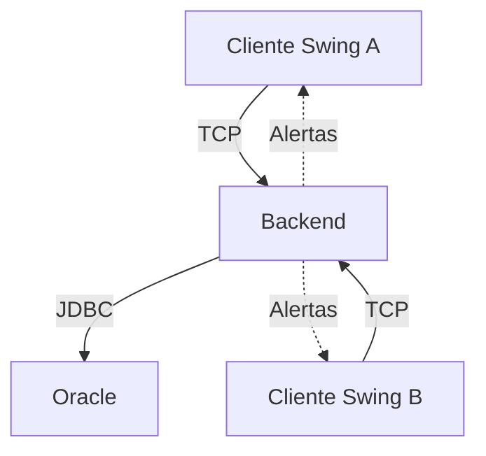

# Sistema de Reserva de Recursos — Proyecto 2

Curso EIF206 Programación 3 — Universidad Nacional de Costa Rica.

Evolución del Proyecto 1 (aplicación Swing con persistencia XML) a una aplicación
distribuida: varios clientes Swing se comunican por sockets con un servidor
que aplica las reglas de negocio y persiste en Oracle.

Cuando alguien crea una reserva, los demás usuarios conectados reciben una
alerta asincrónica.

> Se utiliza Oracle en lugar de MySQL (que menciona el enunciado) por indicación
> del profesor. También por su indicación, la base es local en la computadora
> del servidor: no se usa máquina virtual ni base de datos en red; los clientes
> solo se conectan al Backend por sockets.

## Integrantes y responsabilidades

| Integrante | Responsabilidad |
|------------|-----------------|
| 1 — Steve | Comunicación por sockets, servidor, patrón Proxy y publicación de alertas |
| 2 — Joshua | Servicios, reglas de negocio, repositorios y base de datos Oracle |
| 3 — Scott | MVC del Frontend, pantallas, reportes y alertas en la interfaz |

## Arquitectura distribuida



- Varios Frontend se conectan a un único Backend.
- Los clientes, el servidor y Oracle pueden ejecutarse en máquinas distintas.
- El Frontend no accede directamente a Oracle.
- Frontend y Backend comparten el contrato y los DTO del módulo `comun`.
- El servidor obtiene el autor de las operaciones desde `ContextoSesion`.
- Las vistas contienen la interfaz Swing.
- Los controladores reciben eventos y llaman al servicio.
- El servicio aplica las reglas de negocio.
- Los repositorios realizan las operaciones de persistencia.

## Patrón Proxy

El controlador llama a `IServicioAplicacion`.

En el Frontend, `ProxyServicio` envía la petición por socket. En el Backend,
`ManejadorCliente` la recibe y `Despachador` llama al servicio creado por
`IFabricaServicios`.

| Rol | Clase |
|-----|-------|
| Subject | `contrato.IServicioAplicacion` |
| Proxy | `proxy.ProxyServicio` |
| Receptor del servidor | `red.ManejadorCliente` |
| Despachador de operaciones | `red.Despachador` |
| RealSubject | Servicio real creado por `servicio.IFabricaServicios` |

Los controladores trabajan contra la interfaz del servicio.

Las llamadas lentas deben ejecutarse fuera del hilo de Swing utilizando
`util.Tarea`.

## Alertas asincrónicas

- `red.PublicadorEventos` publica una alerta cuando se crea una reserva
  correctamente.
- La alerta se entrega a los demás usuarios autenticados.
- El autor no recibe su propia alerta.
- Un observador que falla se retira sin afectar a los otros.
- El Frontend registra un `contrato.IReceptorEventos`.
- Las actualizaciones de Swing se realizan con
  `SwingUtilities.invokeLater(...)`.

## Estructura del proyecto

| Módulo o carpeta | Contenido |
|------------------|-----------|
| `comun` | Contrato, DTO y protocolo compartidos |
| `backend` | Servidor, servicios, acceso a datos y repositorios Oracle |
| `frontend` | Proxy, utilitarios y MVC del cliente |
| `DB` | Scripts SQL de Oracle |
| `prompts_proyecto2` | Bitácora de uso de asistentes de IA |

Paquetes del Backend:

| Paquete | Responsabilidad |
|---------|-----------------|
| `red` | Servidor, conexiones, despacho y publicación de eventos |
| `servicio` | Contexto de sesión, fábrica y servicios de aplicación |
| `accesodatos` | Apertura de conexiones JDBC |
| `repositorio` | Acceso a Oracle mediante procedimientos y funciones |
| `falso` | Implementación en memoria para pruebas e integración temprana |

El Backend real implementa el contrato completo con repositorios Oracle de
categorías, funcionarios y autenticación, recursos y disponibilidad, reservas
y estadísticas. `ServicioAplicacion` aplica permisos, validaciones y transacciones;
`FabricaServiciosOracle` comparte el bloqueo entre los clientes del servidor.
La extracción Gemini se ejecuta en el Backend, sin mantener conexiones ni bloqueos.

Detalles de la persistencia: [Implementación Oracle](backend/IMPLEMENTACION_ORACLE.md).

## Configuración de red

`protocolo.Configuracion` lee las siguientes propiedades del sistema:

| Propiedad | Valor predeterminado | Uso |
|-----------|----------------------|-----|
| `servidor.host` | `localhost` | Dirección del Backend |
| `servidor.puerto` | `5000` | Puerto del servidor |
| `servidor.timeout` | `10000` | Espera máxima de una respuesta, en milisegundos |
| `servidor.maxClientes` | `100` | Solo servidor: conexiones atendidas a la vez |
| `servidor.timeoutSinSesion` | `60000` | Solo servidor: milisegundos que espera a que una conexión inicie sesión |

Las conexiones que exceden `servidor.maxClientes` reciben un aviso y se
cierran. Una conexión sin sesión se cierra tras `servidor.timeoutSinSesion` ms;
con sesión iniciada no hay límite de inactividad.

La deserialización utiliza `Configuracion.FILTRO_MENSAJES` para aceptar las
clases permitidas del protocolo y los DTO.

## Funcionalidades

Administrador:

- CRUD de funcionarios.
- CRUD de categorías.
- CRUD de recursos.
- Consulta de recursos por categoría.

Funcionario:

- Crear reservaciones por categorías, fecha y horario.
- Cancelar reservaciones propias.
- Extraer datos desde una frase mediante IA, cuando esté configurada.

Consultas y funciones compartidas:

- Calendarización.
- Agenda semanal.
- Estadísticas.
- Exportación a PDF.
- Búsqueda en tablas.
- Alertas de nuevas reservas.

Los funcionarios se registran con su identificación como clave inicial.
En el primer ingreso deben cambiarla. El servidor lo exige: mientras el
cambio esté pendiente (también para `ADMIN`) rechaza toda operación salvo
cambiar la clave y cerrar sesión, con el código `SESION` y el mensaje
"Debe cambiar su clave antes de continuar.". La clave nueva no puede ser la
actual ni la identificación del usuario.

El teléfono del funcionario es obligatorio y solo admite dígitos, espacios,
`+` y `-`, con 7 a 20 caracteres y al menos 7 dígitos (por ejemplo
`8888-1111` o `+506 8888 1111`). La descripción de cada categoría es única,
sin distinguir mayúsculas ni espacios al inicio o al final.

Las claves se guardan con hash PBKDF2WithHmacSHA256 y sal aleatoria por
usuario (`seguridad.ClaveHash`, formato `pbkdf2$iteraciones$sal$hash` en
`TUSUARIOS.CLAVE`). La verificación se hace en Java; Oracle nunca recibe ni
guarda una clave en texto plano, y una restricción `CHECK` lo impide.

La integración opcional con Gemini utiliza `GEMINI_API_KEY` en el Backend.
No crea reservas: entrega campos para revisar y completar en el Frontend.
Los reportes PDF se generan en el Frontend a partir de los datos del servicio.

## Requisitos

- JDK 17 o superior.
- Maven 3.8 o superior.
- Oracle para la persistencia del Backend.
- Abrir el proyecto desde su carpeta raíz.

## Base de datos Oracle

Se trabaja con Oracle Database 11g Express Edition, versión 11.2.0.2.0.

Esquema del proyecto:

```text
RESERVAS_P2
```

La conexión de SQL Developer puede llamarse `ReservasRecursos`.
Ese nombre es una etiqueta local y no sustituye al usuario ni al SID.

### Ejecución de scripts

Abrir cada archivo en SQL Developer, seleccionar todo su contenido y
ejecutarlo con F5 en la conexión del proyecto.

| Archivo | Contenido | Cuándo ejecutarlo |
|---------|-----------|-------------------|
| `DB/01_tablas_y_secuencias.sql` | Cinco tablas y dos secuencias | Una sola vez en un esquema vacío |
| `DB/02_procedimientos_y_funciones.sql` | Cursores, CRUD, acceso, reservas y estadísticas | Después de `01`; puede repetirse para actualizar las rutinas |
| `DB/03_pruebas_categorias.sql` | Prueba de categorías | Opcional, después de `02` |
| `DB/04_pruebas_recursos.sql` | Pruebas de recursos y relaciones | Opcional, después de `02` |
| `DB/05_pruebas_usuarios.sql` | Pruebas de funcionarios y claves | Opcional, después de `02` |
| `DB/06_datos_iniciales.sql` | Administrador y categorías iniciales | Después de `02` |
| `DB/07_pruebas_reservas.sql` | Pruebas de reservas, disponibilidad y estadísticas | Opcional, después de `02` |

Los scripts de pruebas deshacen sus datos temporales mediante rollback.

El script `06` guarda sus cambios mediante commit.

Si `01` muestra `ORA-00955` en un esquema ya preparado, los objetos ya
existen. Si el esquema se creó con una versión anterior de `01` (sin el
índice único de categorías ni la restricción de claves con hash), hay que
borrar los objetos del esquema y ejecutar de nuevo `01`, `02` y `06`.

Los números consumidos por las secuencias no se recuperan mediante
rollback. Los saltos en los identificadores son normales.

### Datos iniciales

El script `06` crea:

- Usuario: `ADMIN`.
- Clave inicial: `ADMIN`.
- Rol: `ADMINISTRADOR`.
- Primer ingreso pendiente.
- Categorías: Sala para 10 personas, Laptop Windows y Sala de juntas.

La clave de `ADMIN` se escribe ya con hash (literal PBKDF2 generado con
`java -cp backend/target/classes seguridad.ClaveHash ADMIN`).
Si `ADMIN` ya existe, el script conserva su clave; si la tiene en texto plano
(base anterior), la restablece a `ADMIN` con hash y primer ingreso pendiente.

Las categorías iniciales se agregan solamente si no existe una con la misma
descripción.

### Transacciones

Los procedimientos y funciones de `02` no ejecutan commit ni rollback.

El servicio Java controla la transacción completa.

La creación de una reserva debe realizarse con la misma conexión JDBC,
incluyendo la cabecera y todas las asignaciones de recursos.

El servicio debe confirmar todos los cambios o deshacerlos completamente.

### Configuración JDBC

El driver se declara únicamente en `backend/pom.xml`.

Se utiliza `ojdbc11:23.6.0.24.10`, tomado del ejemplo del profesor.

Las pruebas de integración se ejecutan con ese driver y Oracle XE 11.2.0.2.0.
Eso no certifica todas las combinaciones de versiones: compilar o ejecutar
pruebas sin Oracle no valida la persistencia.

Referencia:
[Documentación de compatibilidad JDBC de Oracle](https://www.oracle.com/database/technologies/faq-jdbc.html).

En las configuraciones de ejecución del Backend o de sus pruebas en
IntelliJ, definir estas variables de entorno:

| Variable | Valor |
|----------|-------|
| `DB_URL` | `jdbc:oracle:thin:@localhost:1521:XE` |
| `DB_USER` | `RESERVAS_P2` |
| `DB_PASSWORD` | Clave del usuario `RESERVAS_P2` |
| `ORACLE_IT` | `true` para activar las pruebas de integración Oracle |

La URL utiliza:

- Host: `localhost`.
- Puerto: `1521`.
- SID: `XE`.

Si SQL Developer utiliza otros valores, ajustar `DB_URL`.

`DB_PASSWORD` corresponde al usuario del proyecto, no a `SYSTEM`.

Cada integrante configura sus propias variables. La contraseña no se guarda
en el código ni en configuraciones de IntelliJ compartidas en Git.

### Conexiones y repositorios

`ConexionOracle.abrir()` devuelve una conexión nueva; quien la solicita debe
cerrarla. El servicio no la usa por operación: cada fábrica reutiliza una sola
conexión (`ConexionCompartida`, descrita más abajo).

Los repositorios reciben esa conexión y cierran sus propias sentencias y
cursores. No cierran la conexión ni confirman la transacción.

Esto permite que varios repositorios participen en la misma operación.

`red.MainServidor` arranca el servidor con el servicio falso en memoria.
`arranque.MainServidorOracle` reutiliza `red.Servidor` con la fábrica real.

La aplicación reutiliza una conexión por fábrica (`ConexionCompartida`) y cada operación
trabaja con autocommit desactivado. Abrir una conexión nueva por operación agotaba el
listener de Oracle XE (ORA-12519) con muchas operaciones seguidas; si la conexión deja de
ser válida, se abre otra.
Confirma antes de devolver éxito y revierte ante errores. Al reservar,
consulta disponibilidad y selecciona recursos antes de insertar; la falta
normal de recursos no deja cabecera ni asignaciones parciales. Las categorías
repetidas solicitan recursos distintos. Se asignan en orden de código para
los bloqueos de fila de Oracle.

Una sola fábrica por servidor serializa las operaciones JDBC, también las
modificaciones administrativas y cancelaciones. Es una solución sencilla para
el servidor único del proyecto, no un bloqueo distribuido entre varios
procesos Backend. Las rutinas Oracle mantienen además sus bloqueos y la
revalidación de solapamientos. Evitar modificar datos manualmente mientras
se realizan pruebas concurrentes.

## Compilación

Desde la raíz:

```bash
mvn clean install
```

## Ejecución del servidor Oracle

Desde la raíz, con JDK 17 y Maven disponibles:

```bash
mvn -pl backend -am package -DskipTests
```

Este comando copia las dependencias de ejecución a
`backend/target/dependencias/`: incluye `comun`, **el driver Oracle** y JSON.
No es suficiente ejecutar el servidor Oracle solo con los directorios de clases.

Variables en la **misma terminal que ejecuta Java/Maven**, ejemplo PowerShell:

```powershell
$env:DB_URL = 'jdbc:oracle:thin:@localhost:1521:XE'
$env:DB_USER = 'RESERVAS_P2'
$env:DB_PASSWORD = [System.Net.NetworkCredential]::new('', (Read-Host 'Clave RESERVAS_P2' -AsSecureString)).Password
java -Dservidor.puerto=5000 -cp "backend/target/classes;backend/target/dependencias/*" arranque.MainServidorOracle
```

En Bash (Linux/WSL/macOS):

```bash
export DB_URL='jdbc:oracle:thin:@localhost:1521:XE'
export DB_USER='RESERVAS_P2'
read -rsp 'Clave RESERVAS_P2: ' DB_PASSWORD
export DB_PASSWORD
java -Dservidor.puerto=5000 -cp 'backend/target/classes:backend/target/dependencias/*' arranque.MainServidorOracle
```

Las variables de una configuración de IntelliJ no se heredan automáticamente
en otra terminal. No guardarlas en Git ni imprimirlas. En WSL,
si Oracle está en Windows, puede ser necesario ajustar el host de `DB_URL`
y las reglas del firewall; `localhost` depende de la configuración de red WSL.

El punto de entrada comprueba la conexión antes de aceptar clientes. Con Oracle
disponible muestra `Servidor Oracle de reservas escuchando en el puerto 5000`.
Si falla, revisar variables, listener de Oracle, SID y dependencias.

## Despliegue: un servidor y N clientes

1. **Servidor (una computadora con Oracle):** cargar los scripts `01`, `02` y
   `06`, definir `DB_URL`, `DB_USER` y `DB_PASSWORD` y arrancar
   `arranque.MainServidorOracle` como se indica arriba (opcionalmente con
   `-Dservidor.puerto=5000`, `-Dservidor.maxClientes=...` y
   `-Dservidor.timeoutSinSesion=...`).
2. **Firewall:** permitir conexiones TCP entrantes al puerto del servidor
   (por defecto 5000). En Windows, por ejemplo (PowerShell como administrador):
   `New-NetFirewallRule -DisplayName "Reservas 5000" -Direction Inbound -Protocol TCP -LocalPort 5000 -Action Allow`.
3. **Clientes (N computadoras):** ejecutar `cliente.MainCliente` con
   `-Dservidor.host=IP_DEL_SERVIDOR -Dservidor.puerto=5000` (ver "Ejecución de
   clientes"). Los clientes no necesitan Oracle, el driver JDBC ni
   `DB_PASSWORD`: solo hablan con el servidor por sockets.

En desarrollo, cada integrante puede tener su propio Oracle XE local con los
mismos scripts y el mismo usuario `RESERVAS_P2`, y apuntar sus clientes a
`localhost`; los datos de cada base son independientes. En la defensa se usa
un solo servidor con su base, y los demás equipos se conectan a él como clientes.

### Gemini opcional

| Variable del Backend | Uso |
|----------------------|-----|
| `GEMINI_API_KEY` | Clave privada de Google AI Studio; no se envía al Frontend |
| `GEMINI_MODEL` | Modelo disponible para su cuenta; por defecto `gemini-3.5-flash-lite` |
| `GEMINI_TIMEOUT_SECONDS` | Entre 1 y 120; por defecto 8 segundos |

Sin clave, sin cuota, sin conexión o con respuesta inválida se devuelve un
`ResultadoExtraccionDTO` fallido y comprensible, sin cuerpos de errores externos.
El modelo predeterminado figura en la documentación oficial consultada durante
este trabajo; la disponibilidad y facturación dependen de Google y de su cuenta.
Se puede cambiar sin recompilar. No se ejecutan llamadas reales de pago en pruebas.

Se usa REST `generateContent`, respuesta JSON y cabecera `x-goog-api-key` (no
clave en la URL). Solo se aceptan IDs del catálogo real; se admiten campos
incompletos y se conservan las cantidades de categorías repetidas.

Si se aumenta el tiempo de Gemini, el timeout del Proxy del cliente debe ser
mayor que la operación completa (por ejemplo, `-Dservidor.timeout=40000` si
la construcción del Proxy utiliza esa configuración). Un timeout de red tras
una reserva no implica que Oracle la haya deshecho: consultar antes de reintentar.

Referencias oficiales: [modelos](https://ai.google.dev/gemini-api/docs/models),
[generateContent](https://ai.google.dev/api/generate-content).

### Servidor falso (alternativa sin Oracle)

`MainServidor` conserva el servicio en memoria para pruebas y demostraciones.

Usuarios disponibles en el servicio falso:

- `ADMIN/ADMIN`.
- `F001/F001`.
- `F002/F002`.
- `F003/F003`.

En Windows:

```bash
java -Dservidor.puerto=5000 -cp "comun/target/classes;backend/target/classes" red.MainServidor
```

En Linux o macOS, utilizar `:` como separador del classpath.

El servidor debe mostrar:

```text
Servidor de reservas escuchando en el puerto 5000
```

Si los clientes están en otras computadoras, debe permitirse el acceso al
puerto del servidor en el firewall.

## Ejecución de clientes

Cada cliente utiliza:

```text
-Dservidor.host=IP_DEL_SERVIDOR
-Dservidor.puerto=5000
```

El punto de entrada es `cliente.MainCliente`:

```bash
mvn -pl frontend exec:java -Dservidor.host=IP_DEL_SERVIDOR -Dservidor.puerto=5000
```

Para revisar la interfaz sin servidor: `-Dexec.mainClass=cliente.MainClienteDemo`.
Detalles del cliente, alertas y pruebas del MVC en [frontend/README.md](frontend/README.md).

## Pruebas

| Tipo | Nombre | Ejecución |
|------|--------|-----------|
| Unitarias | `*Test` | `mvn test` |
| Integración | `*IT` | `mvn verify` |

Las pruebas existentes incluyen:

- Protocolo y serialización.
- Proxy del Frontend.
- Despachador, sesiones y errores.
- Reglas del servicio falso.
- Comunicación real por sockets.
- Alertas.

### Pruebas contra Oracle

Clases:

```text
repositorio.RepositorioCategoriasOracleIT
repositorio.RepositoriosOracleIT
servicio.ServicioAplicacionOracleIT
integracion.ServidorOracleIT
```

Requiere:

- Scripts `01` y `02` ejecutados en Oracle.
- Variables JDBC configuradas.
- `ORACLE_IT=true`.

Comprueba:

- Conexión con el usuario configurado.
- Inserción, búsqueda, listado, modificación y eliminación de categorías.
- Listas inmutables.
- Rollback de una inserción.
- CRUD de funcionarios, autenticación, primer ingreso y conservación de clave.
- Claves guardadas con hash (la columna nunca contiene la clave) y rechazo de
  una clave nueva igual a la actual o al ID.
- Descripción de categoría única al registrar y al modificar.
- Primer ingreso exigido por el servidor a través de sockets.
- Recursos, disponibilidad y mapeo de cursores.
- Reservas confirmadas, falta normal sin residuos, categorías repetidas,
  solapamientos y horarios contiguos.
- Rollback real tras la primera asignación, fallo en la segunda.
- Cancelación propia, ajena, repetida e iniciada; restauración de disponibilidad.
- Restricciones de borrado sin eliminar historial, estadísticas, agenda y calendario.
- Dos servicios de la misma fábrica compitiendo por el último recurso.
- Sockets y Proxy originales con servicio y fábrica Oracle, incluyendo alertas.

Las pruebas antiguas de categorías usan rollback. Las nuevas pruebas que hacen
commit crean usuarios temporales `J2IT-...`, categorías y recursos propios
(`soporte.DatosOracle`); limpian exclusivamente sus IDs en `finally`/`@AfterEach`,
en orden de claves foráneas, también si el proceso termina a mitad de una
prueba. No cambian la clave del administrador. Si quedan residuos (proceso
matado o caída de Oracle), en la base local de desarrollo:

```sql
DELETE FROM TRESERVA_RECURSO WHERE ID_RESERVA IN (SELECT ID FROM TRESERVAS WHERE ID_USUARIO LIKE 'J2IT-%');
DELETE FROM TRESERVAS WHERE ID_USUARIO LIKE 'J2IT-%';
DELETE FROM TRECURSOS WHERE CODIGO LIKE 'J2IT-%' OR DESCRIPCION LIKE '%J2IT-%';
DELETE FROM TCATEGORIAS WHERE DESCRIPCION LIKE 'J2IT-%';
DELETE FROM TUSUARIOS WHERE ID LIKE 'J2IT-%';
COMMIT;
```

Nunca vaciar tablas.

Desde la raíz, en PowerShell con las variables JDBC ya configuradas:

```powershell
$env:ORACLE_IT = 'true'
mvn -pl backend -am verify
```

En Bash: `export ORACLE_IT=true` y ejecutar el mismo comando Maven.
Para ejecutar todo el reactor, usar `mvn test` y `mvn verify`.
Sin `ORACLE_IT=true`, las pruebas Oracle se omiten.
Que Maven termine correctamente con esas pruebas omitidas no valida la
conexión a Oracle.

Las pruebas unitarias nuevas utilizan dependencias simuladas (conexión,
repositorios o extractor), sin Oracle ni consumo de Gemini. Comprueban sesión,
permisos, límites, horarios, transacciones, errores y matrices de consultas.

**Verificación de este trabajo:** los resultados reales y las limitaciones del
entorno están registrados en [Implementación Oracle](backend/IMPLEMENTACION_ORACLE.md).

## Protocolo y errores

Cada llamada viaja como `Peticion` y devuelve una `Respuesta`.

El servicio informa los errores al cliente con `ServicioException` y un
`CodigoError`.

| Código | Significado |
|--------|-------------|
| `VALIDACION` | Datos inválidos, duplicados o inexistentes |
| `SESION` | Credenciales incorrectas, sesión no iniciada o cambio de clave pendiente |
| `PERMISO` | Operación no permitida para el usuario |
| `RECURSO_EN_USO` | Eliminación de un registro con asociados |
| `DISPONIBILIDAD` | Horario no disponible, fuera del resultado normal de reserva fallida |
| `PERSISTENCIA` | Fallo de Oracle y operación revertida |
| `COMUNICACION` | Fallo de red informado por el Proxy, servidor lleno o conexión cerrada por inactividad |

La falta normal de recursos al reservar se devuelve mediante
`ResultadoReservaDTO.fracaso(...)`.

Las operaciones sin retorno terminan normalmente cuando tienen éxito.

## Bitácora de prompts

- Proyecto 2: [Bitácora](prompts_proyecto2/PROMPTS_LLM.md).
- Proyecto 1: [Bitácora anterior](bitacora_prompts.txt).

## Repositorio

https://github.com/stevee84/ProyectoP31
