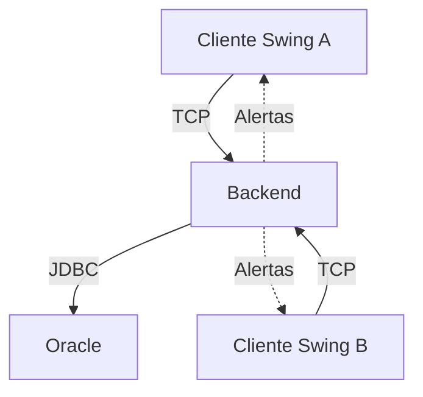

# Sistema de Reserva de Recursos — Proyecto 2

Curso EIF206 Programación 3 — Universidad Nacional de Costa Rica.

Evolución del Proyecto 1 (aplicación Swing con persistencia XML) a una aplicación
distribuida: varios clientes Swing se comunican por sockets con un servidor
que aplica las reglas de negocio y persiste en Oracle.

Cuando alguien crea una reserva, los demás usuarios conectados reciben una
alerta asincrónica.

> Se utiliza Oracle por indicación del profesor.

## Integrantes y responsabilidades

| Integrante | Responsabilidad |
|------------|-----------------|
| 1 — Steve | Comunicación por sockets, servidor, patrón Proxy y publicación de alertas |
| 2 — Joshua | Servicios, reglas de negocio, repositorios y base de datos Oracle |
| 3 — Scott | MVC del Frontend, pantallas, reportes y alertas en la interfaz |

## Arquitectura distribuida



- Varios Frontend se conectan a un único Backend.
- Los clientes, el servidor y Oracle pueden ejecutarse en máquinas distintas.
- El Frontend no accede directamente a Oracle.
- Frontend y Backend comparten el contrato y los DTO del módulo `comun`.
- El servidor obtiene el autor de las operaciones desde `ContextoSesion`.
- Las vistas contienen la interfaz Swing.
- Los controladores reciben eventos y llaman al servicio.
- El servicio aplica las reglas de negocio.
- Los repositorios realizan las operaciones de persistencia.

## Patrón Proxy

El controlador llama a `IServicioAplicacion`.

En el Frontend, `ProxyServicio` envía la petición por socket. En el Backend,
`ManejadorCliente` la recibe y `Despachador` llama al servicio creado por
`IFabricaServicios`.

| Rol | Clase |
|-----|-------|
| Subject | `contrato.IServicioAplicacion` |
| Proxy | `proxy.ProxyServicio` |
| Receptor del servidor | `red.ManejadorCliente` |
| Despachador de operaciones | `red.Despachador` |
| RealSubject | Servicio real creado por `servicio.IFabricaServicios` |

Los controladores trabajan contra la interfaz del servicio.

Las llamadas lentas deben ejecutarse fuera del hilo de Swing utilizando
`util.Tarea`.

## Alertas asincrónicas

- `red.PublicadorEventos` publica una alerta cuando se crea una reserva
  correctamente.
- La alerta se entrega a los demás usuarios autenticados.
- El autor no recibe su propia alerta.
- Un observador que falla se retira sin afectar a los otros.
- El Frontend registra un `contrato.IReceptorEventos`.
- Las actualizaciones de Swing se realizan con
  `SwingUtilities.invokeLater(...)`.

## Estructura del proyecto

| Módulo o carpeta | Contenido |
|------------------|-----------|
| `comun` | Contrato, DTO y protocolo compartidos |
| `backend` | Servidor, servicios, acceso a datos y repositorios Oracle |
| `frontend` | Proxy, utilitarios y MVC del cliente |
| `proyecto1` | Módulo temporal que compila la aplicación anterior desde `src/` |
| `DB` | Scripts SQL de Oracle |
| `prompts_proyecto2` | Bitácora de uso de asistentes de IA |

Paquetes del Backend:

| Paquete | Responsabilidad |
|---------|-----------------|
| `red` | Servidor, conexiones, despacho y publicación de eventos |
| `servicio` | Contexto de sesión, fábrica y servicios de aplicación |
| `accesodatos` | Apertura de conexiones JDBC |
| `repositorio` | Acceso a Oracle mediante procedimientos y funciones |
| `falso` | Implementación en memoria para pruebas e integración temprana |

Actualmente está implementado el repositorio Oracle de categorías.
Los demás repositorios y el servicio real están pendientes de integración.

## Configuración de red

`protocolo.Configuracion` lee las siguientes propiedades del sistema:

| Propiedad | Valor predeterminado | Uso |
|-----------|----------------------|-----|
| `servidor.host` | `localhost` | Dirección del Backend |
| `servidor.puerto` | `5000` | Puerto del servidor |
| `servidor.timeout` | `10000` | Espera máxima de una respuesta, en milisegundos |

La deserialización utiliza `Configuracion.FILTRO_MENSAJES` para aceptar las
clases permitidas del protocolo y los DTO.

## Funcionalidades

Administrador:

- CRUD de funcionarios.
- CRUD de categorías.
- CRUD de recursos.
- Consulta de recursos por categoría.

Funcionario:

- Crear reservaciones por categorías, fecha y horario.
- Cancelar reservaciones propias.
- Extraer datos desde una frase mediante IA, cuando esté configurada.

Consultas y funciones compartidas:

- Calendarización.
- Agenda semanal.
- Estadísticas.
- Exportación a PDF.
- Búsqueda en tablas.
- Alertas de nuevas reservas.

Los funcionarios se registran con su identificación como clave inicial.
En el primer ingreso deben cambiarla.

La integración opcional con Gemini utiliza `GEMINI_API_KEY`.

## Requisitos

- JDK 17 o superior.
- Maven 3.8 o superior.
- Oracle para la persistencia del Backend.
- Abrir el proyecto desde su carpeta raíz.

## Base de datos Oracle

Se trabaja con Oracle Database 11g Express Edition, versión 11.2.0.2.0.

Esquema del proyecto:

```text
RESERVAS_P2
```

La conexión de SQL Developer puede llamarse `ReservasRecursos`.
Ese nombre es una etiqueta local y no sustituye al usuario ni al SID.

### Ejecución de scripts

Abrir cada archivo en SQL Developer, seleccionar todo su contenido y
ejecutarlo con F5 en la conexión del proyecto.

| Archivo | Contenido | Cuándo ejecutarlo |
|---------|-----------|-------------------|
| `DB/01_tablas_y_secuencias.sql` | Cinco tablas y dos secuencias | Una sola vez en un esquema vacío |
| `DB/02_procedimientos_y_funciones.sql` | Cursores, CRUD, acceso, reservas y estadísticas | Después de `01`; puede repetirse para actualizar las rutinas |
| `DB/03_pruebas_categorias.sql` | Prueba de categorías | Opcional, después de `02` |
| `DB/04_pruebas_recursos.sql` | Pruebas de recursos y relaciones | Opcional, después de `02` |
| `DB/05_pruebas_usuarios.sql` | Pruebas de funcionarios y claves | Opcional, después de `02` |
| `DB/06_datos_iniciales.sql` | Administrador y categorías iniciales | Después de `02` |
| `DB/07_pruebas_reservas.sql` | Pruebas de reservas, disponibilidad y estadísticas | Opcional, después de `02` |

Los scripts de pruebas deshacen sus datos temporales mediante rollback.

El script `06` guarda sus cambios mediante commit.

Si `01` muestra `ORA-00955` en un esquema ya preparado, los objetos ya
existen. No es necesario borrarlos ni ejecutar otra vez ese archivo.

Los números consumidos por las secuencias no se recuperan mediante
rollback. Los saltos en los identificadores son normales.

### Datos iniciales

El script `06` crea:

- Usuario: `ADMIN`.
- Clave inicial: `ADMIN`.
- Rol: `ADMINISTRADOR`.
- Primer ingreso pendiente.
- Categorías: Sala para 10 personas, Laptop Windows y Sala de juntas.

Si `ADMIN` ya existe, el script conserva su clave.

Las categorías iniciales se agregan solamente si no existe una con la misma
descripción.

### Transacciones

Los procedimientos y funciones de `02` no ejecutan commit ni rollback.

El servicio Java controla la transacción completa.

La creación de una reserva debe realizarse con la misma conexión JDBC,
incluyendo la cabecera y todas las asignaciones de recursos.

El servicio debe confirmar todos los cambios o deshacerlos completamente.

### Configuración JDBC

El driver se declara únicamente en `backend/pom.xml`.

Se utiliza `ojdbc11:23.6.0.24.10`, tomado del ejemplo del profesor.

La conexión real de ese driver con Oracle XE 11.2.0.2.0 debe comprobarse
ejecutando las pruebas Oracle en esa instalación. Compilar el proyecto
no demuestra esa compatibilidad.

Referencia:
[Documentación de compatibilidad JDBC de Oracle](https://www.oracle.com/database/technologies/faq-jdbc.html).

En las configuraciones de ejecución del Backend o de sus pruebas en
IntelliJ, definir estas variables de entorno:

| Variable | Valor |
|----------|-------|
| `DB_URL` | `jdbc:oracle:thin:@localhost:1521:XE` |
| `DB_USER` | `RESERVAS_P2` |
| `DB_PASSWORD` | Clave del usuario `RESERVAS_P2` |
| `ORACLE_IT` | `true` para activar las pruebas de integración Oracle |

La URL utiliza:

- Host: `localhost`.
- Puerto: `1521`.
- SID: `XE`.

Si SQL Developer utiliza otros valores, ajustar `DB_URL`.

`DB_PASSWORD` corresponde al usuario del proyecto, no a `SYSTEM`.

Cada integrante configura sus propias variables. La contraseña no se guarda
en el código ni en configuraciones de IntelliJ compartidas en Git.

### Conexiones y repositorios

`ConexionOracle.abrir()` devuelve una conexión nueva.

Quien solicita la conexión debe cerrarla al terminar la operación.

Los repositorios reciben esa conexión y cierran sus propias sentencias y
cursores. No cierran la conexión ni confirman la transacción.

Esto permite que varios repositorios participen en la misma operación.

El servidor continúa utilizando el servicio falso hasta integrar el
servicio real y su fábrica.

## Compilación

Desde la raíz:

```bash
mvn clean install
```

## Ejecución del servidor

Mientras se integra la fábrica Oracle, `MainServidor` utiliza el servicio
en memoria.

Usuarios disponibles en el servicio falso:

- `ADMIN/ADMIN`.
- `F001/F001`.
- `F002/F002`.
- `F003/F003`.

En Windows:

```bash
java -Dservidor.puerto=5000 -cp "comun/target/classes;backend/target/classes" red.MainServidor
```

En Linux o macOS, utilizar `:` como separador del classpath.

El servidor debe mostrar:

```text
Servidor de reservas escuchando en el puerto 5000
```

Si los clientes están en otras computadoras, debe permitirse el acceso al
puerto del servidor en el firewall.

## Ejecución de clientes

Cada cliente utiliza:

```text
-Dservidor.host=IP_DEL_SERVIDOR
-Dservidor.puerto=5000
```

El punto de entrada `MainCliente` está pendiente de integración por el
Integrante 3.

La aplicación anterior puede ejecutarse desde la raíz:

```bash
mvn -pl proyecto1 exec:java -Dexec.mainClass=Main
```

Se ejecuta desde la raíz porque utiliza el directorio relativo `data/`.

## Pruebas

| Tipo | Nombre | Ejecución |
|------|--------|-----------|
| Unitarias | `*Test` | `mvn test` |
| Integración | `*IT` | `mvn verify` |

Las pruebas existentes incluyen:

- Protocolo y serialización.
- Proxy del Frontend.
- Despachador, sesiones y errores.
- Reglas del servicio falso.
- Comunicación real por sockets.
- Alertas.
- Pruebas heredadas del Proyecto 1.

### Pruebas contra Oracle

Clase:

```text
repositorio.RepositorioCategoriasOracleIT
```

Requiere:

- Scripts `01` y `02` ejecutados en Oracle.
- Variables JDBC configuradas.
- `ORACLE_IT=true`.

Comprueba:

- Conexión con el usuario configurado.
- Inserción, búsqueda, listado, modificación y eliminación de categorías.
- Listas inmutables.
- Rollback de una inserción.

Los datos de prueba se deshacen.

Desde la raíz:

```bash
mvn -pl backend -am verify
```

Sin `ORACLE_IT=true`, las tres pruebas Oracle se omiten.
Que Maven termine correctamente con esas pruebas omitidas no valida la
conexión a Oracle.

## Protocolo y errores

Cada llamada viaja como `Peticion` y devuelve una `Respuesta`.

El servicio informa los errores al cliente con `ServicioException` y un
`CodigoError`.

| Código | Significado |
|--------|-------------|
| `VALIDACION` | Datos inválidos, duplicados o inexistentes |
| `SESION` | Credenciales incorrectas o sesión no iniciada |
| `PERMISO` | Operación no permitida para el usuario |
| `RECURSO_EN_USO` | Eliminación de un registro con asociados |
| `DISPONIBILIDAD` | Horario no disponible, fuera del resultado normal de reserva fallida |
| `PERSISTENCIA` | Fallo de Oracle y operación revertida |
| `COMUNICACION` | Fallo de red informado por el Proxy |

La falta normal de recursos al reservar se devuelve mediante
`ResultadoReservaDTO.fracaso(...)`.

Las operaciones sin retorno terminan normalmente cuando tienen éxito.

## Bitácora de prompts

- Proyecto 2: [Bitácora](prompts_proyecto2/PROMPTS_LLM.md).
- Proyecto 1: [Bitácora anterior](bitacora_prompts.txt).

## Repositorio

https://github.com/stevee84/ProyectoP31